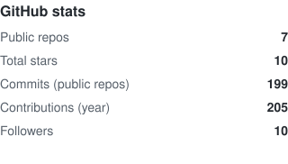
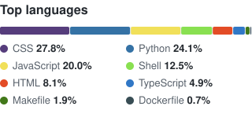

<h1 align="center">Igor Khaylov</h1>

  <b>Backend developer &amp; platform engineer</b> 
  Python · Django · Proxmox · S3 · CI/CD · GPU servers for LLMs · Tashkent, Uzbekistan

  
  
  

---

I write Python and Django backends **and run the production they live on**. At
[Intersoft tech](https://intersoft.uz) I own the server side of the company's key products —
a streaming service, e-learning platforms, museum systems — and the whole infrastructure
underneath: hardware, hypervisors, storage, network, CI/CD, monitoring and GPU servers for
language models. Coding since 2019.

### Right now

- 🧩 **Moving the team to full-stack** with [project-template](https://github.com/igorkhaylov/project-template):
  Django and React in one repository, an OpenAPI contract between them, images ready for Kubernetes
- 🤖 **Leading the fleet system for 12 UBTECH Cruzr humanoid robots** at the Centre of Islamic
  Civilization: our own server instead of the vendor cloud, a web console and the app on the robot's screen
- 🎟️ Launching the **ticketing system of the Centre of Islamic Civilization**: website, kiosks,
  cashier desk, turnstiles and an AI purchase assistant
- 📈 Growing the **monitoring platform** that covers ~85 servers and ~190 services
- 🧠 Running **GPU servers with LLMs**: 8× NVIDIA B200 and 8× RTX PRO 6000

### Infrastructure I'm responsible for

| **~100** servers | **10** Proxmox VE nodes | **1.4 PB** of storage | **166** virtual machines |
| :---: | :---: | :---: | :---: |
| **~870** Docker containers | **~400** domains behind nginx edges | **16** GPUs for AI | **290 TB** of HLS video |

Five sites, bastion-only SSH, MinIO S3, self-hosted CI runners, VictoriaMetrics + Grafana,
runbooks and incident post-mortems. The details are on [igorkhaylov.uz](https://igorkhaylov.uz/en/#infrastructure).

### Selected work

| Project | What it is | My part |
| --- | --- | --- |
| **[SPlay](https://splay.uz)** | Subscription streaming: films, series, live TV and mini-dramas on phones, Smart TVs and the web | Lead backend & DevOps since 2022: core API, billing, AES-encrypted HLS, GPU encoding, live-TV origin, all the infrastructure |
| **[Ilmi](https://ilmi.uz)** · Qizil Pomada | Online courses, master classes and an online school; ~28k users on Ilmi | Sole backend author, own encrypted video hosting |
| **[CIC ticketing](https://igorkhaylov.uz/en/projects/iccu-tickets/)** | Timed sessions, kiosks, cashier desk, turnstiles and an AI assistant for a major museum | Backend architect: ~700 tests, docs for all 84 API routes |
| **[Cruzr Fleet](https://igorkhaylov.uz/en/projects/cruzr/)** | Management system for 12 humanoid guide robots | Lead developer: Django server, React console, Kotlin app on the robot |
| **[Monitoring platform](https://igorkhaylov.uz/en/projects/monitoring/)** | Metrics, logs, alerts and a status page for the whole fleet | Author |
| **[WOSCU](https://woscu.org)** | Portal on the cultural heritage of Uzbekistan | Backend & DevOps |

All 26 projects, with what I did on each: **[igorkhaylov.uz](https://igorkhaylov.uz/en/#projects)**.

### Open source

| Repository | What it is |
| --- | --- |
| **[django-template](https://github.com/igorkhaylov/django-template)** | Production Django 5.2 + DRF starter: PostgreSQL, Redis, Celery, MinIO, Docker, uv, CI/CD to GHCR. The base of ~30 company projects |
| **[project-template](https://github.com/igorkhaylov/project-template)** | Full-stack starter: Django backend + React SPA + ops layer, a shared OpenAPI contract, Kubernetes-ready images |
| **[react-template](https://github.com/igorkhaylov/react-template)** | React 19 + TypeScript frontend starter: Vite, TanStack Router/Query, Tailwind 4, i18n, runtime-configured Docker image |
| **[django-stdimage](https://github.com/igorkhaylov/django-stdimage)** | Maintained fork: Django 5+ storage API, WebP variations, DRF serializers |
| **[portfolio](https://github.com/igorkhaylov/portfolio)** | Source of [igorkhaylov.uz](https://igorkhaylov.uz): bilingual Django site, hand-written front end, served from my own server |

### Tech stack

 

 

### GitHub

<!-- The cards are static SVGs regenerated weekly by .github/workflows/stats.yml —
     the shared github-readme-stats instance kept answering 503. Most of my work lives
     in private organisation repositories, so the cards show public activity only. -->

  <picture>
    <source media="(prefers-color-scheme: dark)" srcset="assets/stats-dark.svg">
    
  </picture>
  &nbsp;&nbsp;
  <picture>
    <source media="(prefers-color-scheme: dark)" srcset="assets/langs-dark.svg">
    
  </picture>

---

<b>🇷🇺 По-русски</b>

 

**Игорь Хайлов** — backend-разработчик и инженер инфраструктуры. Ташкент, Узбекистан.

Пишу backend на Python и Django и сам держу продакшен, на котором он работает. В
[Intersoft tech](https://intersoft.uz) отвечаю за серверную часть ключевых продуктов компании —
онлайн-кинотеатра, образовательных платформ, музейных систем — и за всю инфраструктуру под ними:
железо, гипервизоры, хранилища, сеть, CI/CD, мониторинг и GPU-серверы для языковых моделей.
Программирую с 2019 года.

**Сейчас в работе:**

- перевожу команду на фулстек: [project-template](https://github.com/igorkhaylov/project-template) —
  Django и React в одном репозитории, OpenAPI-контракт между ними, образы готовы к Kubernetes;
- веду разработку системы управления 12 роботами UBTECH Cruzr для Центра исламской цивилизации:
  свой сервер вместо облака вендора, веб-консоль и приложение на экране робота;
- запускаю билетную систему Центра исламской цивилизации: сайт, киоски, касса, турникеты и AI-ассистент;
- развиваю платформу мониторинга на ~85 серверов и ~190 сервисов;
- сопровождаю GPU-серверы с LLM: 8× NVIDIA B200 и 8× RTX PRO 6000.

**Инфраструктура в моей зоне ответственности:** ~100 серверов на пяти площадках, 10 узлов
Proxmox VE, 1,4 ПБ хранилища, 166 виртуальных машин, ~870 контейнеров, ~400 доменов, 16 GPU.

Все проекты и подробности — на [igorkhaylov.uz](https://igorkhaylov.uz).

  Portfolio: <a href="https://igorkhaylov.uz">igorkhaylov.uz</a> · source: <a href="https://github.com/igorkhaylov/portfolio">igorkhaylov/portfolio</a>

